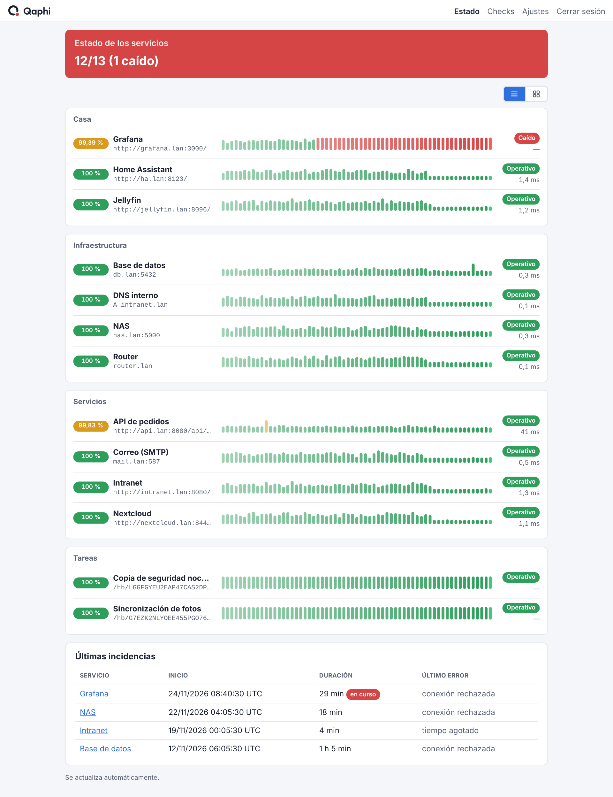
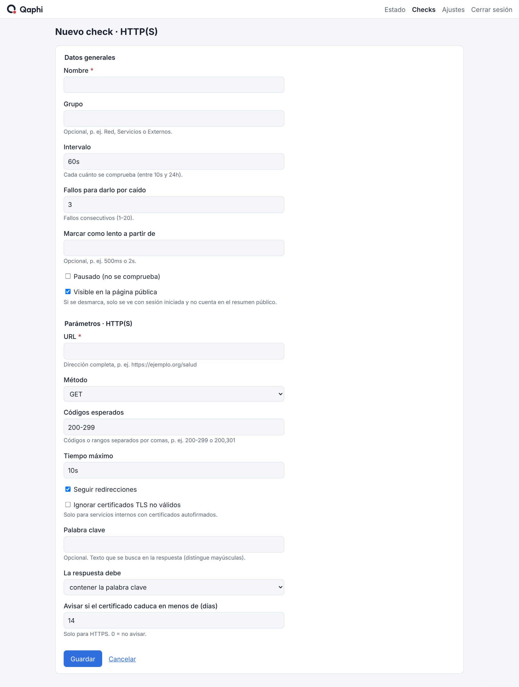
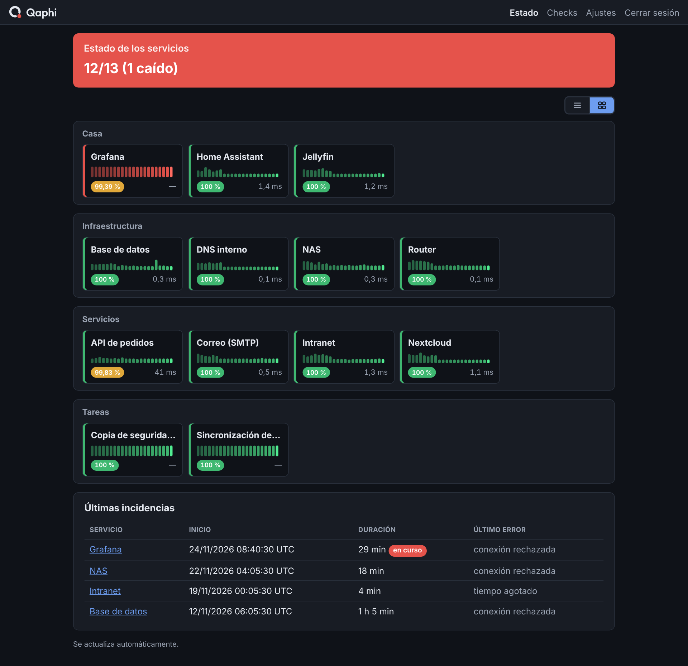
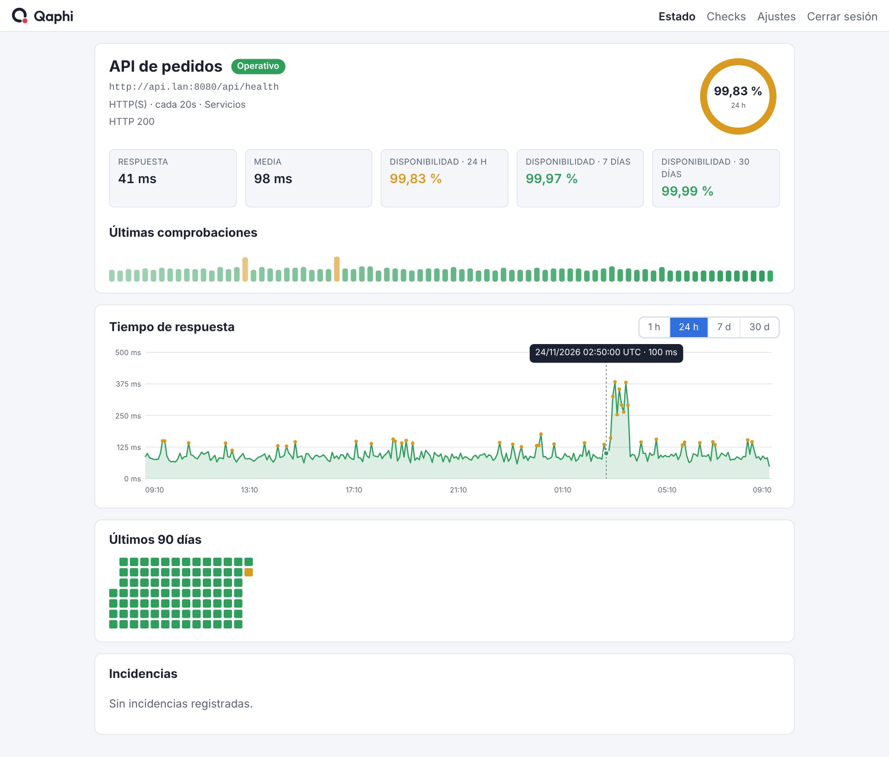
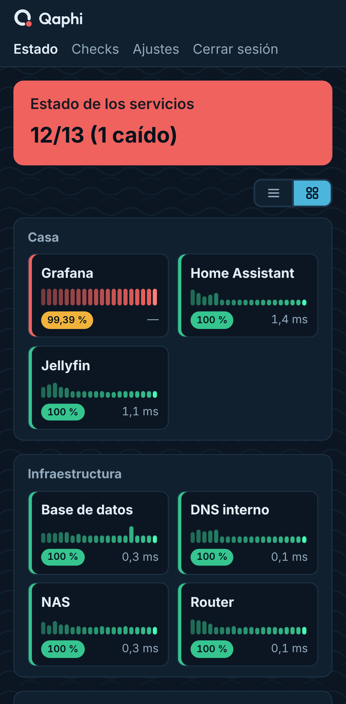
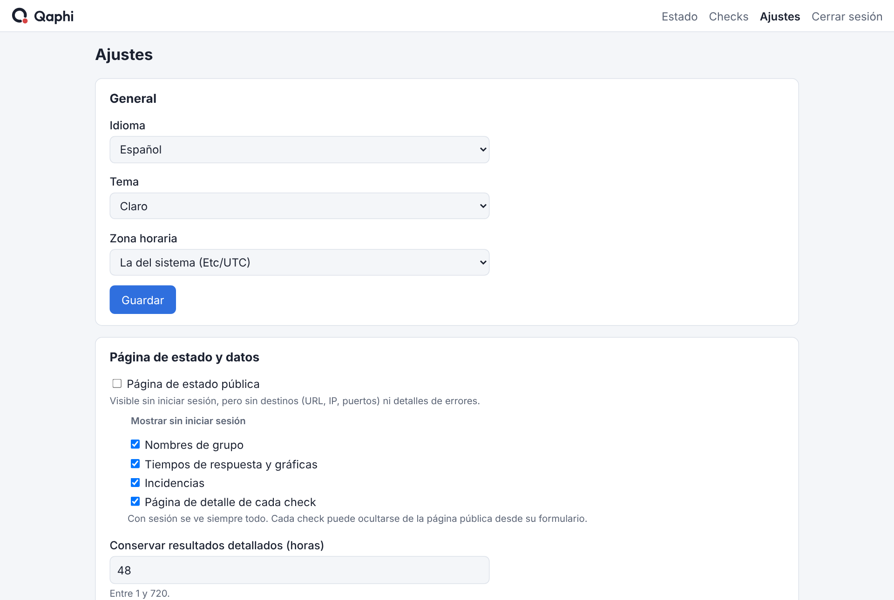

<p align="center">
  
</p>

# Qaphi

Un **monitor de servicios ultraligero** para tu red: comprueba cada pocos segundos si tus webs,
servidores, bases de datos, equipos y tareas programadas siguen funcionando, y lo muestra en una
página de estado con barras de pulsos, gráficas de tiempo de respuesta, disponibilidad e
incidencias. Pensado para equipos modestos, como una NanoPi o una Raspberry Pi, y para quien tiene
su propio servidor en casa o en una pequeña empresa.



- Es **un solo ejecutable**: no hay que instalar Docker, Node, Python ni bases de datos.
- **Se instala y se actualiza con un solo comando**, que conserva los datos y vuelve solo a la
  versión anterior si la nueva no arranca.
- Funciona **sin Internet**: estilos, gráficas, temas e idiomas van dentro del ejecutable.
- Todo se configura desde la **web**; no hay ficheros que editar a mano.
- **Seguro por defecto**: nada es público hasta que usted lo decide, y la página pública nunca
  muestra direcciones, puertos ni errores.
- Interfaz en **castellano, inglés, alemán y francés**, con cinco temas visuales.
- Solo para **Linux** con systemd: amd64, arm64, ARMv7 y ARMv6.

---

## Índice

**Instalar**

1. [Qué hay en cada versión](#1-qué-hay-en-cada-versión)
2. [Requisitos](#2-requisitos)
3. [Instalación](#3-instalación)
4. [Primer acceso](#4-primer-acceso)

**Usar**

5. [Añadir checks](#5-añadir-checks)
6. [La página de estado](#6-la-página-de-estado)
7. [Página pública](#7-página-pública)
8. [Ajustes](#8-ajustes)
9. [Heartbeats: avisar desde tus tareas](#9-heartbeats-avisar-desde-tus-tareas)
10. [Ping (ICMP) y permisos](#10-ping-icmp-y-permisos)

**Mantenimiento**

11. [Actualizar a una versión nueva](#11-actualizar-a-una-versión-nueva)
12. [Contraseña olvidada](#12-contraseña-olvidada)
13. [Ver el log](#13-ver-el-log)
14. [Datos y copias de seguridad](#14-datos-y-copias-de-seguridad)
15. [Diagnóstico de problemas](#15-diagnóstico-de-problemas)
16. [Desinstalar](#16-desinstalar)

**Referencia**

17. [Línea de comandos](#17-línea-de-comandos)
18. [Hoja de ruta](#18-hoja-de-ruta)
19. [Para desarrolladores](#19-para-desarrolladores)
20. [Licencia](#20-licencia)

---

## 1. Qué hay en cada versión

Cada versión publica un ejecutable por arquitectura, con la versión en el nombre, y un fichero de
sumas de verificación. Todos están en la
[página de versiones](https://github.com/Future-Chocolate6122/Qaphi/releases).

| Fichero | Para |
|---|---|
| `qaphi_<versión>-linux-amd64` | PC o servidor normal de 64 bits (Intel o AMD) |
| `qaphi_<versión>-linux-arm64` | ARM de 64 bits: Raspberry Pi 3/4/5 con sistema de 64 bits, servidores ARM |
| `qaphi_<versión>-linux-armv7` | ARM de 32 bits: NanoPi NEO, Raspberry Pi 2/3 con sistema de 32 bits |
| `qaphi_<versión>-linux-armv6` | Raspberry Pi Zero y Raspberry Pi 1 |
| `SHA256SUMS_<versión>` | Sumas para comprobar que el fichero ha llegado íntegro |

La versión va sin la «v» y con guiones bajos: la `v0.3.2` es `qaphi_0_3_2-linux-amd64`.

Si no sabe cuál es la suya, `uname -m` lo dice: `x86_64` → amd64, `aarch64` → arm64,
`armv7l` → armv7, `armv6l` → armv6.

Dónde queda cada cosa una vez instalado:

| | Ruta |
|---|---|
| Programa | `/usr/local/bin/qaphi` |
| Datos (base de datos SQLite) | `/var/lib/qaphi/qaphi.db` |
| Opciones de arranque | `/etc/qaphi/qaphi.env` (lo genera el instalador; no se edita a mano) |
| Servicio | `qaphi` (systemd), con el usuario de sistema `qaphi` |

---

## 2. Requisitos

- Linux con **systemd** (Debian, Ubuntu, Armbian, Raspberry Pi OS, Fedora…).
- Acceso como **root** (`sudo`) para instalar.
- Nada más: el instalador crea el usuario, la carpeta de datos y el servicio.

Se recomienda que el equipo tenga la hora sincronizada (NTP), algo que Armbian y Raspberry Pi OS
traen de serie. En equipos sin reloj propio, Qaphi no registra resultados hasta que la hora es
correcta, para no guardar fechas erróneas.

---

## 3. Instalación

1. Descargue el ejecutable de su arquitectura y el fichero de sumas. Los enlaces de la versión
   actual (0.3.2) son estos; para otra versión o arquitectura, cambie el número o el final del
   nombre:

   ```bash
   wget https://github.com/Future-Chocolate6122/Qaphi/releases/download/v0.3.2/qaphi_0_3_2-linux-amd64
   ```

   ```bash
   wget https://github.com/Future-Chocolate6122/Qaphi/releases/download/v0.3.2/SHA256SUMS_0_3_2
   ```

   Si el equipo no tiene salida a Internet, descárguelos en su PC y cópielos con `scp`:

   ```bash
   scp qaphi_0_3_2-linux-amd64 SHA256SUMS_0_3_2 usuario@IP_DEL_EQUIPO:
   ```

2. Compruebe que ha llegado íntegro (debe decir `OK`):

   ```bash
   sha256sum -c --ignore-missing SHA256SUMS_0_3_2
   ```

3. Dele permiso de ejecución:

   ```bash
   chmod +x qaphi_0_3_2-linux-amd64
   ```

4. Instale:

   ```bash
   sudo ./qaphi_0_3_2-linux-amd64 install
   ```

   El instalador crea el usuario de sistema `qaphi` (sin contraseña ni shell), copia el programa a
   `/usr/local/bin/qaphi`, crea `/var/lib/qaphi`, registra el servicio, lo arranca y comprueba que
   responde. Al terminar muestra la dirección y el **token de configuración inicial**:

   ```text
   OK: Qaphi v0.3.2 installed and running.

     Initial setup:
       Open in your browser: http://192.0.2.10:9077/setup
       Setup token: ABCD-EFGH-IJKL-MNOP
   ```

   Los mensajes de consola y el log están en inglés; la interfaz web, en su idioma.

Comprobar que el servicio está en marcha:

```bash
systemctl status qaphi
```

Por defecto Qaphi escucha en el **puerto 9077 por HTTP** en todas las interfaces. Puede cambiar
la dirección, el puerto o pasar a HTTPS desde la web (ver [8. Ajustes](#8-ajustes)).

---

## 4. Primer acceso

Abra en el navegador la dirección que mostró el instalador (`http://IP_DEL_EQUIPO:9077`). Mientras
no haya contraseña, Qaphi le lleva a `/setup`, que pide:

- El **token de configuración inicial**, que solo sirve una vez. Si no lo apuntó:

  ```bash
  journalctl -u qaphi | grep token
  ```

- El **idioma** de la interfaz (se preselecciona el de su navegador).
- La **contraseña** de administración, de 10 caracteres como mínimo. El usuario es siempre
  `admin`.

Después entrará en la página de estado, vacía hasta que añada el primer check.

> Qaphi tiene un único usuario. Tras 5 intentos fallidos en 15 minutos, la IP queda bloqueada
> 15 minutos. Las sesiones duran 7 días (se puede cambiar en Ajustes).

---

## 5. Añadir checks

En **Checks → Nuevo check**, elija el tipo y rellene el formulario. Cada tipo muestra solo sus
campos, con una ayuda debajo de cada uno.



| Tipo | Qué comprueba | Opciones |
|---|---|---|
| **HTTP(S)** | Que una web o API responde con el código esperado | URL, método (GET o HEAD), códigos esperados (`200-299`, `200,301`…), tiempo máximo, seguir redirecciones, ignorar certificados no válidos, **palabra clave** que debe aparecer (o no) en la respuesta y **aviso de caducidad del certificado** (14 días por defecto) |
| **TCP** | Que un puerto acepta conexiones (como `tcping`) | Equipo, puerto y tiempo máximo |
| **Ping (ICMP)** | Que un equipo está encendido y alcanzable | Equipo, número de pings (1–10) y tiempo máximo. Ver [10](#10-ping-icmp-y-permisos) |
| **DNS** | Que un nombre se resuelve, y opcionalmente a qué | Nombre, tipo de registro (A, AAAA, CNAME, MX, TXT, NS), servidor DNS (vacío = el del sistema) y valor esperado |
| **Heartbeat** | Que una tarea programada avisa a tiempo | Periodo y margen. Ver [9](#9-heartbeats-avisar-desde-tus-tareas) |

Opciones comunes a todos:

| Opción | Por defecto | Qué hace |
|---|---|---|
| **Grupo** | ninguno | Agrupa los checks en la página de estado («Red», «Servicios»…) |
| **Intervalo** | 60 s | Cada cuánto se comprueba (de 10 s a 24 h). Debe ser mayor que el tiempo máximo del check |
| **Fallos para darlo por caído** | 3 | Fallos seguidos necesarios para marcarlo como caído (1–20). Mientras tanto aparece como «pendiente», así un fallo aislado no abre una incidencia |
| **Marcar como lento a partir de** | — | Si la respuesta tarda más, el check aparece como «lento» (ámbar) aunque funcione |
| **Pausado** | no | Deja de comprobarse. Pausar un check caído cierra su incidencia |
| **Visible en la página pública** | sí | Ver [7. Página pública](#7-página-pública) |

**Estados de un check**: operativo (verde), lento (ámbar: supera el umbral de lentitud o su
certificado está a punto de caducar), pendiente (naranja: está fallando, pero aún no llega al número
de fallos), caído (rojo), sin permisos (gris: el sistema no deja hacer ping), pausado y desconocido.

**Incidencias**: cuando un check se da por caído se abre una incidencia, que empieza en el primer
fallo de la racha y se cierra cuando se recupera, con su duración. Se guardan en el momento, así
que no se pierden aunque se corte la luz.

---

## 6. La página de estado

La página de inicio (**Estado**) muestra todos los checks por grupos y se actualiza sola cada
pocos segundos, sin recargar.

- **Banner** con el estado global: «12/13 (1 caído)».
- **Disponibilidad** de las últimas 24 h de cada check, con su color.
- **Barra de pulsos**: las últimas comprobaciones. La altura indica el tiempo de respuesta, el
  color el resultado, y la última «late». Al pasar el ratón se ve la hora y el detalle.
- **Últimas incidencias**, con su duración y el último error.
- **Logotipo y pestaña del navegador**: el punto del logotipo toma el color del estado global, y el
  icono de la pestaña también, con el anillo en rojo si hay caídas. El título de la pestaña
  muestra el número de servicios caídos, por ejemplo «(1) Estado de los servicios».

Con el selector de arriba a la derecha se cambia entre **lista** y **cuadrícula**; la cuadrícula
muestra muchos más servicios en el mismo espacio. Cada navegador recuerda su elección.



Al pulsar un check se abre su **página de detalle**:

- Estado, último resultado, tiempo de respuesta actual y medio.
- Disponibilidad a 24 h, 7 días y 30 días, con un anillo de la de 24 h.
- **Gráfica del tiempo de respuesta** de la última hora, 24 h, 7 días o 30 días, con las caídas
  marcadas en rojo y las respuestas lentas en ámbar.
- **Mapa de los últimos 90 días**, un cuadro por día.
- Sus incidencias.



La interfaz se adapta al móvil:



---

## 7. Página pública

Por defecto, la página de estado solo se ve con sesión iniciada. En **Ajustes → Página de estado y
datos** puede activar la **página de estado pública**, que se ve sin iniciar sesión.

En la página pública **nunca** se muestran las direcciones (URL, IP, puertos), los mensajes de
resultado ni los errores. Además, puede decidir qué más se ve, en **Mostrar sin iniciar sesión**:

| Opción | Si se desmarca |
|---|---|
| Nombres de grupo | Todos los checks aparecen juntos, sin revelar cómo están organizados |
| Tiempos de respuesta y gráficas | Se ocultan los tiempos; las barras de pulsos tienen todas la misma altura |
| Incidencias | No se muestra el historial de caídas |
| Página de detalle de cada check | Los checks no se pueden abrir; solo se ve la página de inicio |

Cada check tiene además la casilla **«Visible en la página pública»**. Los checks ocultos no
aparecen ni cuentan en el resumen público, y en la lista de **Checks** llevan la etiqueta
«no público».

Todo se filtra en el servidor, no solo en pantalla: lo que está oculto no llega al navegador.
Con sesión iniciada se ve siempre todo.

---

## 8. Ajustes



**General**

| Ajuste | Opciones |
|---|---|
| Idioma | Castellano, inglés, alemán o francés, para toda la instalación |
| Tema | Automático (claro u oscuro según el sistema), Claro, Oscuro, **Océano** (oscuro, azules) y **Arena** (claro, cálido) |
| Zona horaria | La del sistema o cualquier otra; afecta a las fechas que se muestran |

**Página de estado y datos**

| Ajuste | Por defecto | Qué hace |
|---|---|---|
| Página de estado pública | no | Ver [7](#7-página-pública) |
| Conservar resultados detallados | 48 h | Cuánto tiempo se guarda cada comprobación (1–720 h) |
| Conservar resúmenes por hora | 90 días | Cuánto tiempo se guardan los resúmenes por hora y las incidencias (7–730 días) |
| Guardar solo resúmenes | no | Menos escrituras en disco, recomendable en tarjetas microSD. La gráfica de 1 h usa solo los datos en memoria |
| Duración de la sesión | 168 h (7 días) | De 1 h a 8760 h |

**Red**

| Ajuste | Opciones |
|---|---|
| Dirección de escucha | Todas las interfaces, solo este equipo (127.0.0.1) o una IP concreta |
| Puerto | Por defecto 9077; desde 1024 (Qaphi no tiene permiso para puertos más bajos) |
| Protocolo | **HTTP** o **HTTPS** con un certificado autofirmado que genera Qaphi (y que se puede regenerar) |

Los cambios de red se aplican **sin reiniciar** y hay que **confirmarlos en 2 minutos** desde la
dirección nueva. Si no se confirman (por ejemplo, porque el cortafuegos bloquea el puerto nuevo),
Qaphi vuelve solo a la configuración anterior, así que no se queda sin acceso.

Con HTTPS, el navegador avisará la primera vez de que el certificado no es de confianza: es
normal con un certificado autofirmado.

---

## 9. Heartbeats: avisar desde tus tareas

Un check **Heartbeat** funciona al revés que los demás: es su tarea (una copia de seguridad, un
script de cron…) la que avisa a Qaphi de que ha funcionado. Si no avisa dentro del periodo más el
margen, el check se da por caído.

Al crear el check, Qaphi genera una dirección única, que se ve en su página y en la lista de
checks:

```text
http://IP_DEL_EQUIPO:9077/hb/TOKEN
```

Basta con llamarla al terminar la tarea (vale GET, POST o HEAD). Por ejemplo, en cron:

```bash
0 3 * * * /usr/local/bin/copia.sh && curl -fsS -m 10 http://IP_DEL_EQUIPO:9077/hb/TOKEN > /dev/null
```

Con HTTPS y el certificado autofirmado, añada `-k` a `curl`. El token es secreto: no aparece en
la página pública ni en el log.

---

## 10. Ping (ICMP) y permisos

Linux no deja hacer ping a cualquier programa. El servicio que crea el instalador ya tiene el
permiso necesario (`CAP_NET_RAW`), así que **no hay que hacer nada**.

Si ejecuta Qaphi a mano, sin el instalador, y los checks de ping aparecen como **«sin permisos»**,
tiene dos opciones:

- Permitir el ping sin privilegios a todos los usuarios del sistema:

  ```bash
  sudo sysctl -w net.ipv4.ping_group_range="0 2147483647"
  ```

- O dar el permiso solo al ejecutable:

  ```bash
  sudo setcap cap_net_raw+ep ./qaphi
  ```

---

## 11. Actualizar a una versión nueva

Descargue el ejecutable nuevo (pasos 1 a 3 de la [instalación](#3-instalación)) y ejecute **el
mismo comando** que la primera vez:

```bash
sudo ./qaphi_0_3_2-linux-amd64 install
```

El instalador detecta la instalación y:

1. Para el servicio de forma ordenada (guarda los resultados pendientes).
2. Hace una copia de la base de datos (`/var/lib/qaphi/qaphi.db.bak`) y del programa anterior
   (`/usr/local/bin/qaphi.prev`).
3. Sustituye el programa y lo vuelve a arrancar, **solo si estaba en marcha**.
4. Comprueba que responde. Si no, **vuelve solo a la versión anterior** con sus datos.

Se conservan todos los datos y las opciones de arranque. Instalar una versión más antigua que la
instalada requiere `--force`.

---

## 12. Contraseña olvidada

La contraseña solo se puede cambiar desde la consola del equipo:

```bash
sudo qaphi reset-password
```

El comando para el servicio, pide la contraseña nueva, cierra todas las sesiones y vuelve a
arrancar el servicio.

---

## 13. Ver el log

Qaphi escribe en el diario de systemd. Para seguirlo en directo:

```bash
journalctl -u qaphi -f
```

En el nivel normal (`info`) solo se registran los cambios de estado (un servicio que cae o se
recupera, un check que no tiene permisos) y las acciones de administración, nunca cada
comprobación, para no desgastar la tarjeta microSD. Las contraseñas y los tokens nunca se
escriben en el log.

Para ver más detalle, cambie el nivel (se conserva en las actualizaciones):

```bash
sudo qaphi install --log-level=debug
```

---

## 14. Datos y copias de seguridad

Todo (configuración, checks, resultados e incidencias) está en `/var/lib/qaphi/qaphi.db`.

- Los resultados se guardan en disco cada 5 minutos, en un solo bloque, para escribir poco. Las
  incidencias y los cambios de configuración se guardan en el momento. Ante un corte de luz se
  pierden, como mucho, los últimos 5 minutos de resultados.
- Para hacer una copia, pare el servicio, copie el fichero y vuelva a arrancarlo:

  ```bash
  sudo systemctl stop qaphi
  ```

  ```bash
  sudo cp /var/lib/qaphi/qaphi.db ~/qaphi-copia.db
  ```

  ```bash
  sudo systemctl start qaphi
  ```

Solo puede funcionar **una instancia** de Qaphi por equipo: una segunda se niega a arrancar.

---

## 15. Diagnóstico de problemas

| Síntoma | Qué hacer |
|---|---|
| No se abre la página | Compruebe que el servicio está en marcha (`systemctl status qaphi`) y en qué dirección escucha: `journalctl -u qaphi \| grep "qaphi started"`. Si hay cortafuegos, abra el puerto (9077 por defecto). |
| Cambié la red y no puedo entrar | Espere 2 minutos: si no se confirmó, Qaphi vuelve solo a la configuración anterior. Como último recurso, fije una dirección por HTTP: `sudo qaphi install --listen=0.0.0.0:9077` (y quítela después con `sudo qaphi install --listen=`). |
| El navegador avisa del certificado | Es normal con HTTPS y el certificado autofirmado de Qaphi. |
| Un check de ping sale «sin permisos» | Ver [10](#10-ping-icmp-y-permisos). |
| Un check sale caído pero el servicio funciona | Abra su detalle: el último mensaje dice por qué falla (código HTTP inesperado, palabra clave no encontrada, tiempo agotado…). Revise el tiempo máximo y los códigos esperados. |
| Las fechas salen con otra hora | Elija su zona horaria en **Ajustes → General**. |
| No se registra nada tras encender el equipo | El equipo no tiene la hora sincronizada todavía; Qaphi empieza en cuanto NTP la ajusta (se ve en el log). |
| «another instance is already running» | Ya hay un Qaphi en marcha en el equipo (probablemente el servicio). |
| Ha olvidado la contraseña | Ver [12](#12-contraseña-olvidada). |

---

## 16. Desinstalar

Quita el servicio, el programa y el usuario `qaphi`, y **conserva los datos** en `/var/lib/qaphi`:

```bash
sudo qaphi uninstall
```

Borrando también los datos:

```bash
sudo qaphi uninstall --purge
```

---

## 17. Línea de comandos

```text
qaphi [serve] [opciones]       arranca el servidor (lo hace el servicio)
qaphi install [opciones]       instala o actualiza el servicio (como root)
qaphi uninstall [--purge]      desinstala; conserva los datos salvo --purge
qaphi reset-password           cambia la contraseña de administración
qaphi version [--short]        muestra la versión
qaphi help                     muestra la ayuda
```

Opciones de arranque (también como variable de entorno). Con `qaphi install` se guardan y se
conservan en las actualizaciones:

| Opción | Variable | Por defecto | Qué hace |
|---|---|---|---|
| `--listen` | `QAPHI_LISTEN` | — | Fija dirección y puerto (solo HTTP) por encima de lo configurado en la web. Es un recurso de emergencia; mientras está fijada, los ajustes de red de la web quedan bloqueados |
| `--data-dir` | `QAPHI_DATA_DIR` | `./data` (`/var/lib/qaphi` en el servicio) | Carpeta de datos |
| `--log-level` | `QAPHI_LOG_LEVEL` | `info` | `debug`, `info`, `warn` o `error` |
| `--log-format` | `QAPHI_LOG_FORMAT` | `text` | `text` o `json` |
| `--flush-interval` | `QAPHI_FLUSH_INTERVAL` | `5m` | Cada cuánto se guardan los resultados en disco (de 10 s a 1 h) |

Para probarlo sin instalar, basta con ejecutarlo; guarda los datos en `./data`:

```bash
./qaphi_0_3_2-linux-amd64
```

---

## 18. Hoja de ruta

Qaphi se desarrolla por fases. Ya están las comprobaciones, la página de estado, la página
pública, los temas y los idiomas. Lo siguiente:

- **Avisos**: ntfy, Telegram, webhook y correo (SMTP), con «Enviar prueba» y plantillas de
  mensaje. Un aviso al caer y otro al recuperarse, sin repeticiones.
- **Dependencias** entre checks (si cae el router, no avisan todos los que dependen de él) y
  **modo mantenimiento**.
- **API JSON** con tokens, `qaphi status` para la consola, y exportar e importar la configuración.
- Más tipos de check (certificados TLS de cualquier servicio, TCP con respuesta esperada, HTTP con
  JSON, SNMP…).

---

## 19. Para desarrolladores

Requisitos: Go 1.27 y `make`. Sin CGO: todo compila de forma cruzada desde cualquier Linux.

```bash
make             # binario para este equipo en bin/
make check       # gofmt, go vet y tests
make cross       # las cuatro arquitecturas en dist/
make release VERSION=v0.3.2   # cross + SHA256SUMS_0_3_2
make size        # tamaño de los binarios de dist/
```

Estructura: `cmd/qaphi` (arranque y subcomandos), `internal/checks` (tipos de check),
`internal/state` (estados, incidencias y disponibilidad), `internal/scheduler`,
`internal/store/sqlite` (base de datos y migraciones), `internal/web` (servidor, plantillas, CSS y
JavaScript embebidos), `internal/theme` (temas), `internal/msg` (textos en los cuatro idiomas),
`internal/netcfg` (red y HTTPS), `internal/install` (instalador) y `docs/` (memoria del proyecto y
logotipo).

Los tipos de check, los temas y los componentes visuales son **módulos**: cada uno es un fichero
que se registra solo y declara sus campos y sus textos, así que añadir uno nuevo no obliga a tocar
el resto.

---

## 20. Licencia

Qaphi se distribuye bajo la **licencia MIT** (fichero [`LICENSE`](LICENSE)): se puede usar, copiar,
modificar y redistribuir libremente, conservando el aviso de copyright.

El ejecutable incluye componentes de terceros:

| Componente | Para qué | Licencia |
|---|---|---|
| Biblioteca estándar de Go | Todo el programa, incluida la base de datos de zonas horarias | BSD de 3 cláusulas |
| `modernc.org/sqlite` (y `libc`, `mathutil`, `memory`) | Base de datos SQLite sin CGO | BSD de 3 cláusulas (SQLite es de dominio público) |
| `golang.org/x/crypto` | Contraseña de administración (bcrypt) | BSD de 3 cláusulas |
| `golang.org/x/net` | Ping (ICMP) | BSD de 3 cláusulas |
| `golang.org/x/sys` | Llamadas al sistema | BSD de 3 cláusulas |
| `github.com/google/uuid` | Dependencia de SQLite | BSD de 3 cláusulas |
| `github.com/remyoudompheng/bigfft` | Dependencia de SQLite | BSD de 3 cláusulas |
| `github.com/dustin/go-humanize` | Dependencia de SQLite | MIT |
| Outfit (solo la forma de las letras del logotipo, convertidas a trazados) | Logotipo | SIL Open Font License 1.1 |

Las traducciones al alemán y al francés se ofrecen tal cual; si quiere mejorarlas, las
contribuciones son bienvenidas.
